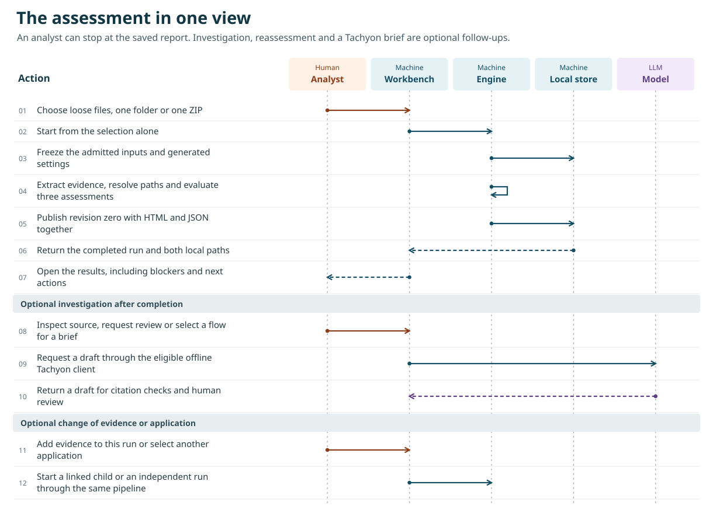

# From resource files to a migration assessment

**The analyst chooses the application files once.** The workbench inventories them, follows dependencies, evaluates complexity, confidence and readiness, then saves the HTML and JSON reports. An analyst can leave with those reports. A domain expert, architect, planning lead or optional model enters the workflow when there is a specific question to investigate.

[Open the overview at full size](00-overview.svg). Read each diagram from top to bottom. A column belongs to one participant, labeled **Human**, **Machine** or **LLM**. The dot marks the sender and the arrowhead marks the recipient. A solid arrow requests or performs work, a dashed arrow returns a result, and a bent arrow shows a participant acting locally. Shaded headings identify the condition for the rows beneath them. Follow the branch that applies. All diagrams open as local SVG files.

## Follow the assessment

| Where you are | Sequence | What to look for |
|---|---|---|
| Before an application is submitted | [01 · Environment and offline setup](01-setup.svg) | The build lead and QA reviewer establish the permitted host and storage. Tachyon eligibility is a separate decision. |
| Selecting resources | [02 · Admission](02-admission.svg) | Loose files, folder or ZIP enter through the same operation. Duplicate submissions reopen their run. A structurally invalid selection gets a receipt and remedy. |
| Discovering what was supplied | [03 · Classification](03-inventory.svg) | Extensionless, mislabeled, duplicate, unsupported and unreadable files each have a visible disposition. The engine continues through per-file uncertainty. |
| Reading source code | [04 · Code extraction](04-extraction.svg) | COBOL, copybooks, JCL, SQL and CICS/BMS observations carry their physical spans. Lookalikes, dynamic operands and unsupported syntax have distinct outcomes. |
| Reading other evidence | [05 · Resource and document extraction](05-documents.svg) | A schedule row can document order. A permission command documents declared access. A runbook paragraph can lead a reviewer to evidence about restart. |
| Connecting components | [06 · Resolution and graph construction](06-resolution.svg) | Follow Harbor's job-step-to-dataset binding and Cedar's transaction-to-table path. Shared reads, dynamic targets and ambiguous definitions remain visible. |
| Reaching a planning decision | [07 · Scoring and actions](07-scoring.svg) | Seven dimensions feed three independent answers. An action identifies who could address a blocker, what to collect and how to verify closure. |
| Receiving the result | [08 · Atomic publication](08-publication.svg) | The snapshot, HTML and JSON share a revision. An all-unsupported selection still produces a coverage report. A failed write produces a diagnostic. |
| Recovering a run | [09 · Cancellation, interruption and retry](09-recovery.svg) | Refresh restores progress. Cancellation or interruption ends the attempt. A linked retry preserves its history. |

## Explore a completed result

| Who acts | Sequence | What changes |
|---|---|---|
| Analyst or planning lead | [10 · Impact and original evidence](10-investigation.svg) | Follow a blocker through a capped graph or keyboard-accessible table to the original source. Missing or changed source has an explicit locator state. |
| Architect | [11 · Boundary investigation](11-boundary.svg) | Inspect a proposed group, external writers and crossing edges. Compare alternate membership and retain its rationale. |
| Domain expert and planning lead | [12 · Human review](12-review.svg) | Confirm, correct, reject, retract or record a justified exclusion. Stale reviews return a conflict. The rubric evaluates evidence when an action is closed or a risk accepted. |
| Analyst with new evidence | [13 · Child run and comparison](13-reassessment.svg) | Add one schedule CSV or correct an expert setting. Compare both versions and see which checks changed, even when all three headline results stay the same. |
| Reviewer and eligible model | [14 · Optional Tachyon brief](14-brief.svg) | The client provides bounded evidence. The model proposes an interpretation. The workbench validates citations and the human judges meaning. Model unavailability, invalid output and incomplete context remain visible. |
| Analyst and report recipient | [15 · Offline handoff and application reuse](15-handoff.svg) | Read the saved reports or generate a reviewed copy. Assess Cedar with a fresh application identity, then compare scopes using the same tool and rubric. |
| Implementer, independent reviewer and demo lead | [16 · Extension and acceptance](16-validation.svg) | Register an analyzer or rule, evaluate held-out cases, and collect actual evidence for the single end-to-end demonstration. |

## Three paths worth walking

- **Harbor Stock.** In [resolution](06-resolution.svg), BUILD can write the dataset and REPORT can read it. In [scoring](07-scoring.svg), the handoff supports a provisional batch complexity signal. In [reassessment](13-reassessment.svg), a usable schedule row documents the job order. The missing restart procedure can still keep the operational gate open.
- **Unsupported input.** A valid folder containing only binaries passes [admission](02-admission.svg). [Classification](03-inventory.svg) accounts for every binary, and [publication](08-publication.svg) returns unknowns and the smallest useful replacement request. An empty or unsafe archive stops at admission.
- **Cedar Permits.** [Resource extraction](05-documents.svg) reads the transaction definition and declared access. [Resolution](06-resolution.svg) connects the transaction to its program and table. [Impact investigation](10-investigation.svg) opens the supporting lines. [Handoff and reuse](15-handoff.svg) shows where the same display name still leads to an independent assessment.

## Scenario coverage

Each row points to the sequence that owns the decision or its outcome. The 35 identifiers are the planned acceptance cases. Additional paths for setup, the optional model, source-review failures and storage recovery appear in the sequences above. These diagrams describe intended behavior. Execution results belong in the [validation plan](../plans/05-validation-and-demo.md) and [delivery checklist](../todo.md).

| Acceptance cases | Decision or outcome | Sequence |
|---|---|---|
| IN-01, IN-02, FLOW-01 | Equivalent input forms and logical paths, no metadata or prompts, unsafe structure rejected | [Admission](02-admission.svg) · [Publication](08-publication.svg) |
| IN-03, IN-04, IN-05, FLOW-02 | Distinct logical identities, individual failures, extensionless members, ambiguous layout, mixed workload and unrelated notes | [Classification](03-inventory.svg) · [Documents](05-documents.svg) · [Resolution](06-resolution.svg) |
| AN-01, AN-02, AN-03 | Literal and dynamic calls, lookalikes, continued statements, cyclic includes and unexpanded COPY forms | [Extraction](04-extraction.svg) · [Resolution](06-resolution.svg) |
| AN-04, AN-05 | Context-specific DD bindings and no fictitious step from in-stream text | [Extraction](04-extraction.svg) · [Resolution](06-resolution.svg) |
| AN-06, AN-07, AN-08 | Static versus dynamic SQL/CICS operands, field qualification and bounded behavior candidates | [Extraction](04-extraction.svg) · [Impact and evidence](10-investigation.svg) |
| EV-01, EV-02 | Conflicts, unrelated material, stale source and verified stored spans | [Documents](05-documents.svg) · [Impact and evidence](10-investigation.svg) · [Review](12-review.svg) |
| GR-01, GR-02, GR-03 | Cycles, self-loops, parallel edges, disconnected nodes, traversal/display limits and shared readers | [Resolution](06-resolution.svg) · [Impact and evidence](10-investigation.svg) |
| GR-04, FLOW-07 | Inspect a blocker and an overlapping boundary with a crossing dependency, trace to source and compare app scopes | [Impact and evidence](10-investigation.svg) · [Boundary](11-boundary.svg) · [Handoff](15-handoff.svg) |
| AS-01, AS-02, FLOW-05 | High complexity can coexist with readiness after review. All-unsupported and structurally invalid selections have different terminal outcomes. | [Scoring](07-scoring.svg) · [Publication](08-publication.svg) · [Admission](02-admission.svg) |
| AS-03, AS-04, FLOW-04 | New usable evidence or reviewed resolution changes an affected check while other gaps can persist | [Child comparison](13-reassessment.svg) · [Review](12-review.svg) |
| RV-01 | Concurrent reviews with a stale expected revision | [Review](12-review.svg) |
| RP-01, RP-02, FLOW-06 | Offline revision parity, cancellation, retry, duplicate submission and interrupted publication | [Admission](02-admission.svg) · [Publication](08-publication.svg) · [Recovery](09-recovery.svg) · [Handoff](15-handoff.svg) |
| RE-01, FLOW-03 | Fresh Cedar assessment using ordinary resources, independent identity, same logic and rubric | [Resolution](06-resolution.svg) · [Handoff](15-handoff.svg) |
| RE-02 | Add a first-party analyzer or rule with independent evidence checks | [Extension and acceptance](16-validation.svg) |

For the input and output contracts behind these exchanges, see the [files-to-results plan](../plans/07-files-to-results.md). For the plain-language walkthrough, see the [companion learning guide](../learn/09-files-to-results.md).
