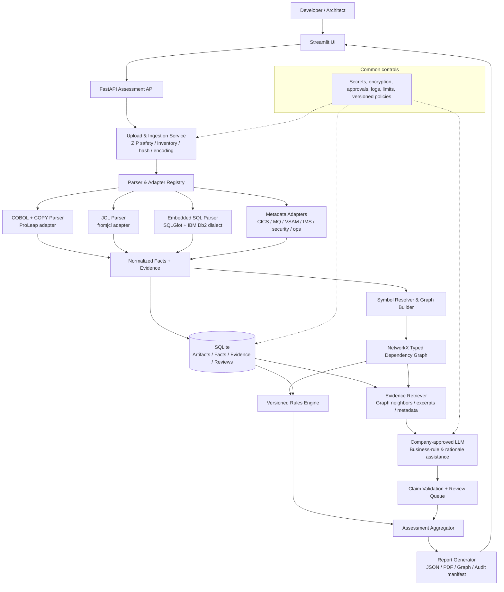
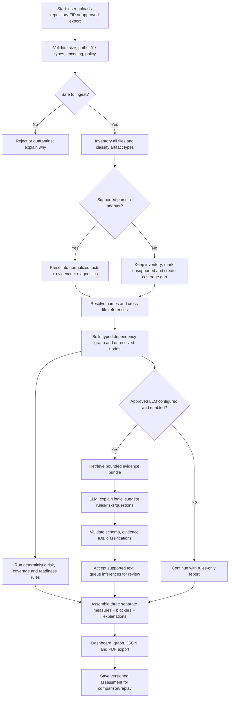
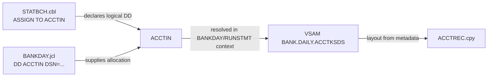

# M2O Insight — Implementation Plan

**Version:** 1.0 — 24 November 2026  
**Purpose:** Enterprise hackathon implementation specification  
**System type:** Reusable, evidence-driven **mainframe application assessment accelerator**  
**Status:** Proposed design; dependencies, security handling, and enterprise LLM connectivity require company approval.

> **One-sentence goal:** Ingest any *supported subset* of an unfamiliar mainframe application's repository and metadata, discover and explain its components and dependencies, assess migration **complexity**, assessment **confidence**, and migration-planning **readiness** separately, and generate an evidence-backed report with unresolved questions and next steps.

> **Honest coverage promise:** The tool can accept **arbitrary repositories** and inventory their contents. It cannot reliably understand *every* mainframe language, dialect, proprietary scheduler, and artifact without an appropriate parser/adapter. Unknown or unsupported inputs must be surfaced explicitly, never silently ignored or treated as low-risk.

---

## 1. Executive decision

Build **one deterministic assessment engine with targeted LLM enrichment**, not a general-purpose autonomous migration agent.

### In scope

1. Upload local ZIP/repository snapshot or an **approved** read-only repository export.
2. Discover and inventory programs, copybooks, JCL, CICS transactions, Db2 objects, VSAM datasets, MQ integrations, IMS/other system references, API/file integrations, and non-code operational/security metadata *where provided and supported*.
3. Parse supported input with open-source parsers and configuration adapters; retain detailed evidence and parser warnings.
4. Resolve cross-artifact dependencies into a typed, navigable knowledge graph.
5. Assess the **eight required domains** and report separate complexity, evidence confidence, and readiness results.
6. Explain rules, cite source evidence, distinguish **evidence-based / inferred / assumed / unknown** findings.
7. Use the company's approved LLM to extract *candidate* business rules, explain modernization implications, generate evidence-aware questions and report narratives.
8. Permit reviewer decisions, export JSON and PDF, and run the same pipeline on a second unrelated sample with **no changes to assessment code**.
9. Suggest **candidate** modernization groupings and next investigations where sufficient evidence exists; do **not** prescribe a final migration solution.

### Explicitly out of scope

- Automatic COBOL-to-Java/.NET conversion, JCL rewriting, live database migration, actual container builds, OpenShift cluster deployment, execution of uploaded source/JCL, automatic decommissioning, or claims of functional equivalence.
- Full application runtime discovery without runtime access and approvals.
- Automatic selection of OpenShift as the only acceptable target.
- Unlimited support for every proprietary mainframe asset on day one.

### Design principles

**Deterministic first · evidence before interpretation · unsupported is visible · LLM never validates itself · no irreversible actions · reusable adapters and versioned rules.**

---

## 2. Traceability to the actual hackathon statement

The screenshots of the supplied challenge statement call M2O **“A Utility for Objective Refactoring.”** It is an **assessment accelerator**; participants are not required to convert, containerize, or migrate applications. OpenShift is a *possible* destination, not mandatory.

### Required assessment domains

| # | Domain | MVP coverage and evidence | If metadata is absent |
|---|---|---|---|
| 1 | Application and business logic | COBOL programs, static/dynamic calls, copybooks, business-rule candidates, non-supported language inventory | Unknown behavior / specialist review |
| 2 | Data structures | Record declarations, COPY, REDEFINES/OCCURS/COMP-3, encoding indicators, shared layouts | Unknown physical record/data contract |
| 3 | Database and persistence | Embedded Db2 SQL, table CRUD references, VSAM access, dataset metadata, IMS references if available | Unknown runtime table/file characteristics |
| 4 | Jobs, batch and orchestration | JCL jobs, steps, PROC, DD names, datasets; scheduler metadata if supplied | Schedule, restart, windows unknown |
| 5 | Online transactions and UI | CICS commands, CICS transaction mapping, COMMAREA/BMS metadata where available | Transaction entry points and state unknown |
| 6 | Integrations and external dependencies | MQ commands/configuration, datasets, files, API and external program references; other supported manifest types | Integration contracts/ownership unknown |
| 7 | Security and controls | RACF/security extracts, access inventories, policy metadata, encryption and audit documentation where provided | Security assessment **not assessed**; specialist review |
| 8 | Operations and nonfunctional requirements | SLAs, availability, latency, recovery, production scheduling, test assets, support model | Readiness blockers and unanswered questions |

### Suggested judging criteria (weights from the provided statement)

| Category | Weight | Concrete feature that earns it |
|---|---:|---|
| Breadth of analysis | **25%** | The eight-domain inventory, source **and** metadata adapters, explicit coverage/gaps |
| Accuracy and evidence | **25%** | Typed facts, exact line/file or metadata path, parser tests, unresolved-reference status, validation |
| Reusability | **20%** | Generic ingestion, parser registry, normalized schema, versioned rules, second-repo demo |
| Explainability | **15%** | Explain-every-score panel, evidence replay, AI claim citations, human review |
| Extensibility | **10%** | Adapter interface, rule packs, schema versioning, configurable mappings |
| Usability | **5%** | Upload → assessment → drill-down → export, clear unknowns and actions |

**Score-maximizing priority:** breadth + accuracy + reusability = **70%** of the suggested total; build these before a complex agent framework.

### Required minimum definition of done

- [ ] Reusable input model, tool/workflow/rules engine.
- [ ] Multidimensional assessment beyond code volume.
- [ ] Explainable **complexity, confidence, readiness** linked to evidence and unknowns.
- [ ] Structured developer/architect report **with a relationship graph** and next steps.
- [ ] Reuse guide for another engineer/application.
- [ ] Limitations, assumptions, unsupported input, evidence gaps, required human validation.
- [ ] Demonstration that **adding/removing evidence changes the assessment as expected**.

---

## 3. Industry features to borrow — without copying proprietary products

| Public industry reference | Valuable approach | Our implementation within hackathon scope |
|---|---|---|
| **Google Cloud Mainframe Assessment Tool** | Inventory, call/data dependency graphs, migratable-unit concepts, business-rule extraction | Typed dependency graph; **candidate** assessment groups; traceable business-rule cards; no transformation |
| **AWS Transform for mainframe** | Cross-domain discovery, shared analysis knowledge, technical documentation, business-function mapping, human review | Evidence-backed knowledge layer; scoped LLM explanations; reviewer workflow; no code generation |
| **Microsoft Azure assessment guidance** | Workload inventory, compatibility and operational checks, integration mapping, specialist validation, readiness blockers | Eight-domain readiness checklist; unknown/owner questions; optional candidate sequencing with rationale |

References (consulted November 2026): [Google MAT overview](https://docs.cloud.google.com/mainframe-assessment-tool/docs/overview), [Google business-rule extraction](https://docs.cloud.google.com/mainframe-assessment-tool/docs/business-rules-extraction), [AWS Transform workflow](https://docs.aws.amazon.com/transform/latest/userguide/transform-app-mainframe-workflow.html), [Microsoft workload assessment](https://learn.microsoft.com/en-us/azure/cloud-adoption-framework/plan/assess-workloads-for-cloud-migration).

**No cloud-vendor product is needed at runtime.** We are borrowing assessment *patterns*, not proprietary models, transformation logic, or vendor-specific claims of capability.

---

## 4. Architecture and diagrams

### 4.1 Block diagram — components and responsibility boundaries



**Key separation:** Parser facts and validated evidence are stored before the LLM runs. LLM-generated content is a distinct claim layer, not a substitute for the fact layer.

### 4.2 Workflow diagram — exact processing and error paths



### 4.3 Sequence diagram — who calls whom

```mermaid
sequenceDiagram
  autonumber
  actor User as Engineer
  participant UI as Streamlit
  participant API as FastAPI
  participant In as Ingestion
  participant P as Parser Registry
  participant DB as Evidence Store
  participant Gr as Graph/Resolver
  participant Ru as Rules
  participant AI as Enterprise LLM
  participant V as Validator/Reviewer
  participant Re as Report
  User->>UI: Upload ZIP and start assessment
  UI->>API: POST /assessments
  API->>In: Validate and snapshot artifact set
  In-->>DB: Store manifest, hashes and unsupported types
  loop Each supported artifact
    In->>P: Parse content with format-specific adapter
    P-->>DB: Facts, evidence spans, warnings
  end
  API->>Gr: Resolve symbols and DD/CICS/SQL relationships
  Gr-->>DB: Typed edges and unresolved targets
  API->>Ru: Evaluate rules on facts, graph and gaps
  Ru-->>DB: Domain findings and provisional measures
  opt Approved model is enabled
    API->>AI: Minimal authorized evidence bundle
    AI-->>V: Candidate business rules / explanations
    V->>DB: Validate evidence IDs; queue review
  end
  API->>Re: Build versioned JSON/PDF with evidence links
  Re-->>UI: Dashboard, graph, findings, next steps
  UI-->>User: Inspect evidence and export assessment
```

### 4.4 Relationship example — why cross-file joins matter



The final `STATBCH → dataset` edge is **contextual** (the program executing in a particular job step), not a global truth for all executions of that program.

---

## 5. Universal ingestion: how it handles unfamiliar repositories

Do **not** hardcode the ABC Bank names, a specific folder layout, one repository, or one organization's dataset naming pattern.

### Input modes

- **MVP:** ZIP upload or local directory snapshot; preserve relative file paths and byte hashes.
- **Optional approved integration:** Read-only Git export or approved internal source repository connector. The FAQ states AI tools cannot directly access source stored in Endevor; obtain a permitted export or mirror before analysis. **Never automatically pull confidential data into an unapproved environment.**
- **Additional metadata:** Optional CSV/JSON/YAML manifests with schema validation for CICS, Db2, VSAM, MQ, schedulers, RACF/security, operations, owners, test assets. Preserve the raw source and its provenance.

### Discovery strategy

1. Expand safely: reject path traversal, symlinks where disallowed, decompression bombs, excessive file count/size, nested archive abuse.
2. Create repository snapshot ID and SHA-256 per artifact; record path, bytes, detected/declared encoding, timestamps if trusted, content type and adapter version.
3. Classify by **extension + content signature + user mapping**; do not rely on extension alone (`.txt`, `.pds`, `.cpy`, `.cbl`, `.cob`, `.jcl`, `.proc`, `.bms`, `.xml`, `.json`, etc.).
4. Decode according to explicit metadata where possible; try approved EBCDIC/ASCII codecs with diagnostic reporting, keep original bytes. Do not silently guess encodings.
5. Route to parser registry: `supports(artifact, hints) -> capability`, `parse(artifact) -> FactBatch`.
6. If a parser fails, retain the artifact and diagnostic, mark extraction partial/not assessed; **do not silently use an LLM as a fake parser**.
7. Support manifest-based library/include paths to resolve copybooks and JCL procedures. If ambiguous, record multiple candidates rather than selecting arbitrarily.
8. Normalize labels but preserve original names, case, qualifiers, source file, and context.

### Parser interface (contract)

```python
from typing import Protocol

class ArtifactParser(Protocol):
    parser_id: str
    version: str

    def supports(self, artifact, context) -> bool: ...
    def parse(self, artifact, context) -> "FactBatch": ...

# FactBatch contains:
# components, relationships, evidence, unresolved_references,
# parser_diagnostics, supported_constructs, unsupported_constructs
```

The **capability registry** declares which language/dialect, constructs, file formats and versions each adapter supports. A new adapter is installed without rewriting the scoring, report, or graph layers.

---

## 6. Concrete open-source parser selection

**Important licensing distinction:** “Open source” means inspectable/licensed code, **not** “pre-approved by the enterprise.” IT/security/legal must approve the exact package version, its transitive dependencies and distribution/deployment model. The licenses below were checked against public repository documentation in November 2026, but are **candidates** only.

| Input / feature | Candidate parser / adapter | Reported license | What we extract | Maturity/caveat and priority |
|---|---|---|---|---|
| COBOL syntax, COPY, variables, procedures, calls | **[ProLeap COBOL Parser](https://github.com/uwol/proleap-cobol-parser)** (ANTLR4/Java service) | **MIT** | AST/ASG, program ID, CALL, COPY, data declarations, control-flow features | **P0.** Requires JDK 17 and bridge to Python. Dialect/format fixture tests. Embedded `EXEC SQL`/`EXEC CICS` are made available as text, so further parsing is necessary. |
| Mainframe JCL | **[fromjcl](https://github.com/msradam/fromjcl)** | **Apache-2.0** | Job, steps, EXEC PGM/PROC, DD, DSN, dispositions | **P0.** Pure Python, Python 3.12+. Newer project; test PROC nesting, symbolic parameters, continuation and in-stream data. Maintain fallback/diagnostics. |
| Embedded Db2 SQL | **[SQLGlot](https://github.com/tobymao/sqlglot)** + **[IBM Db2 SQLGlot plugin](https://github.com/IBM/db2-sqlglot-plugin)** | **MIT + Apache-2.0** | SQL AST, read/write table references, statement types | **P0/P1.** Plugin public docs specify Python 3.10–3.12; choose Python **3.12**. Extract SQL from COBOL first; validate SQL dialect coverage against fixtures. Dynamic SQL stays unresolved. |
| Alternative Db2 SQL | **[JSQLParser](https://github.com/JSQLParser/JSqlParser)** | **Apache-2.0 OR LGPL-2.1** | Db2 SQL syntax and table references | **Fallback** if approved SQLGlot adapter fails important fixtures. Choose Apache branch explicitly; Java bridge cost. |
| CICS embedded commands | ProLeap command spans + **small tested CICS command extractor** | Our own code | `LINK`, `XCTL`, `START`, `READ`, `WRITE`, resources, PROGRAM and transaction references | **P0 for key commands**, limited supported grammar. Do not treat unknown commands as fully parsed. |
| CICS transaction definitions / BMS maps | JSON/CSV/XML adapter using Python stdlib and validation | Python license + our code | Transaction→program, maps, file resource names, control links | **P1.** Works only for explicitly declared supported input schemas/formats; BMS text parsing is stretch. |
| VSAM and datasets | COBOL file declaration extraction + JCL DD resolver + JSON/CSV/IDCAMS export adapter | Our code | KSDS/ESDS/RRDS identifiers, record keys, file mode, dataset mapping | **P0/P1.** VSAM isn't simply one language with a ready universal parser; integrate evidence from several artifacts. |
| IBM MQ | COBOL `CALL`/MQ API command detection + MQ configuration/manifest adapter | Our code | MQ API use, queue/manager references, message contract hints, unknown queue targets | **P1.** Not every MQ program exposes queue names statically. Runtime config must be provided to verify them. |
| IMS / DL/I | Recognize `EXEC DLI`, `EXEC SQLIMS`, calls, and supplied IMS metadata | Our code; optional verified grammar later | Program→IMS resource references | **P1/P2.** Make unknowns explicit; no unsupported completeness claims. |
| PL/I, HLASM, Natural, Easytrieve, proprietary schedulers | File/type inventory + plugin slot; specialist-provided metadata | To be reviewed | Limited declarations and externally supplied relationships only | **P2.** Mark **not parsed** unless approved, tested parser added. |
| Security, operational and integration manifests | Python `json`, `csv`, XML parsing + Pydantic schema checks | Python / MIT (Pydantic) | RACF resource records, owners, SLAs, restart rules, schedulers, APIs, MQ/FTP mappings | **P0 via structured metadata**, with provenance and format-specific schema. |

**Avoid accidental license mistakes:** The MIT **ProLeap parser** is distinct from the **`proleap-cobol` analysis/transform project**, whose GitHub repository lists AGPL-3.0. Do not automatically import AGPL conversion tools into the assessment product. Eclipse Che4z COBOL Language Support is another possible reference, but is EPL-2.0 and heavier to integrate; assess legal and technical cost before adopting.

### Required parser implementation behaviors

- **COBOL:** Detect fixed/free format, comments, continuation, `COPY`/`REPLACE`, static vs variable `CALL`, `EXEC CICS`/`EXEC SQL` spans, `OCCURS`, `REDEFINES`, `COMP-3`; report dialect unsupported constructs.
- **JCL:** Step context is mandatory (`JOB` → `STEP` → `DD`), include PROC and symbolic resolution only when the needed source is supplied, distinguish program execution from a JCL symbol.
- **SQL:** Differentiate `SELECT`/`UPDATE`/`INSERT`/`DELETE`; retain an unresolved marker for dynamic SQL, unbound host variables, and unknown schemas.
- **CICS:** Distinguish `LINK`, `XCTL`, `START`, `READ`, `WRITE`, transaction mapping and BMS map references. CICS static source and runtime metadata have different reliability.
- **MQ:** Distinguish presence of an API call from a *verified queue name*; config keys and dynamic names can prevent full resolution.
- **VSAM:** Resolve logical file declarations to DD name, job-step allocation and dataset; classify file organization and use available volume/record metadata only when supplied.

### Parser qualification test before enabling a technology

1. Version and license approved; dependencies inventoried.
2. Test fixtures for valid syntax, comments, multiline constructs and incorrect syntax.
3. Required fact extraction has a documented precision/recall benchmark against human-labeled examples.
4. Every extracted fact yields source location + extractor version or an explicit diagnostic.
5. Failure in one artifact does not stop the entire assessment.
6. Coverage matrix updated automatically and report labels partial/unsupported cases.

---

## 7. Normalized data model and evidence provenance

All parser adapters return the **same schema**. Suggested database entities:

- `AssessmentRun`: snapshot ID, input hashes, config/rules/model versions, time, status.
- `Artifact`: path, type, dialect, encoding, SHA-256, parser, parse status, unsupported flags.
- `Component`: globally scoped identity, type, original name, namespace/context, state (`FOUND`, `REFERENCED_ONLY`, `AMBIGUOUS`).
- `Relationship`: source/target IDs, typed edge, execution/context qualifiers, resolution state.
- `Evidence`: artifact ID, start/end lines/columns **or** JSON pointer/metadata locator, excerpt hash, extractor and confidence basis.
- `Finding`: rule or AI claim, domain, classification, severity, supporting evidence IDs, rationale, affected components.
- `Unknown`: question, required artifact/owner, impact, blocked decision, priority.
- `Review`: reviewer identity/time, accept/reject/clarify, rationale, original and revised classification.
- `AssessmentScore`: domain/value/status, weight, rules hit, evidence coverage, policy version.

**Example relationship** (illustrative):

```json
{
  "source": "repoA:PROGRAM:BANKSRV",
  "target": "repoA:DB2_TABLE:BANK_ACCOUNT",
  "type": "READS_TABLE",
  "resolution": "RESOLVED",
  "classification": "EVIDENCE_BASED",
  "execution_context": null,
  "evidence_ids": ["EV-0042"],
  "extractor": "db2-sql-adapter@1.0.0"
}
```

**Do not conflate**: the text `CALL 'FOO'` being present (evidence-based) with a runnable `FOO` module existing (may be unresolved); or a source table reference with an observed production call count (unavailable without runtime evidence).

### Entity resolution algorithm

1. Index declarations by type + name + namespace/location (program IDs, copybooks, jobs, procedures, transactions, tables, datasets, MQ resources).
2. Resolve explicit references with context: copybook search paths, JCL job/step, DB qualifier, CICS definitions.
3. If exactly one target matches and source semantics support it, create `RESOLVED` relationship.
4. If none match, create a `REFERENCED_ONLY` node and a missing-target unknown.
5. If more than one matches, mark `AMBIGUOUS`; do not choose one at random.
6. Create derived **contextual** edges only with a provenance chain back to their source relations.
7. Preserve graph changes between assessment runs for the evidence-delta feature.

### Graph storage choice

Use **NetworkX** for graph operations and a small relational edge store in **SQLite** for persistence. Avoid requiring Neo4j or a vector database for the MVP. Store relationship type, source evidence, status and context as edge properties (`MultiDiGraph` is suitable).

---

## 8. Deterministic analysis and scoring policy

Three **separate** decision measures are mandatory. These are **proposed hackathon scoring rules**, not an official standard; publish the versioned policy and make every score reproducible without the LLM.

### 8.1 Complexity — how hard might modernization be?

An eight-domain, weighted risk model. Suggested default weights (configurable):

| Domain | Weight | Example risk indicators |
|---|---:|---|
| Application/business logic | 20% | Dynamic calls, shared routines, large control flow, missing program source |
| Data structures | 10% | `REDEFINES`, `OCCURS DEPENDING ON`, `COMP-3`, EBCDIC layouts, record sharing |
| Database/persistence | 15% | Db2/IMS/VSAM coupling, dynamic SQL, shared writes/locking, unknown consistency |
| Jobs/batch | 15% | Job fan-out, proc/scheduler dependencies, tight batch window, restart behavior |
| Online transactions/UI | 10% | CICS commands, COMMAREA, state/transaction boundary complexity |
| Integration/external | 15% | MQ, APIs, files, upstream/downstream services, dynamic resource names |
| Security/controls | 10% | RACF dependencies, access paths, audit/encryption obligations |
| Operations/NFR | 5% | High availability, recovery, response/throughput constraints |
| **Total** | **100%** | |

Each domain contains individual **rule IDs** with documented severities, applicability and evidence requirements, e.g. `DATA-COMP3-001`, `JCL-RESTART-002`, `CICS-STATE-003`, `MQ-EXT-004`.

**Per-domain risk:** Normalize supported triggered-rule severity (and appropriate exposure/coupling evidence) into `0–100`; do not add identical risks multiple times for every repeated statement. Keep rules small and testable. A real number is output **only if minimum domain evidence coverage passes its threshold**; otherwise status is `NOT_ASSESSED` or `PROVISIONAL`.

**Overall complexity:** weighted mean of assessable domain risks, displayed **provisionally** if required domains are missing. Never insert zero for missing domains. Disclose assessed weight (e.g. 65/100 weight covered) and do not publish a definitive whole-application `Low` if critical domains are unassessed.

Suggested labels: `0–34 Low`, `35–64 Medium`, `65–100 High`. These are examples, not official hackathon thresholds.

### 8.2 Assessment confidence — how good is the evidence?

Proposed **evidence-quality index**, not probability of migration success:

```text
Confidence = 0.40 * ExpectedEvidenceCoverage
           + 0.25 * TraceabilityCompleteness
           + 0.20 * ReliabilityAndFreshness
           + 0.15 * CriticalUnknownResolution
```

Inputs are 0–100 and weighted by the importance of relevant domain evidence. Unsupported artifacts, contradictory records, incomplete parsing, stale data and unresolved dynamic references lower appropriate submeasures. A missing artifact is **unknown**, not confirmed absence.

### 8.3 Migration-planning readiness — can planning responsibly begin?

Score separately from complexity using evidence-backed prerequisites:

| Readiness prerequisite | Weight |
|---|---:|
| Application ownership and scope identified | 15% |
| Current architecture and component inventory sufficient | 15% |
| Critical dependencies documented/resolved | 20% |
| Testing assets and verification approach available | 20% |
| Operational and recovery requirements available | 15% |
| Security/compliance review and obligations available | 15% |
| **Total** | **100%** |

Each prerequisite has status `VERIFIED`, `PARTIAL`, `NOT_AVAILABLE`, or `UNKNOWN`, determined from evidence and reviewer decisions. Example math: verified = 1, partial = 0.5, absent/unknown = 0 **for readiness only**; unknowns still stay visible and lower confidence. A mandatory blocker (`NO_TEST_STRATEGY`, `UNKNOWN_DATA_OWNER`, etc.) may cap the readiness label even when the numeric score is high. The report must display blockers alongside the score.

### 8.4 Suggested component-level candidate classification

`CANDIDATE_FOR_FURTHER_EVALUATION`, `REQUIRES_DEEP_ANALYSIS`, `RETAIN_FOR_NOW_PENDING_EVIDENCE`, or `INSUFFICIENT_EVIDENCE`. These are **assessment triage labels**, **not** final migration/retention decisions or prescribed OpenShift patterns.

### 8.5 Make every score explain itself

For each domain: **risk indicator → rule ID → evidence IDs → score contribution → confidence/coverage → reviewer notes → recommended investigation**. Rules and weights are stored in versioned YAML; no mysterious opaque AI score.

---

## 9. LLM integration — strictly bounded and valuable

Use the **approved internal enterprise LLM only**. Never send company source code to public AI services without explicit authorization. API key stays in a secret manager/environment, not a repo or report.

### Where the LLM *will* be used

| LLM capability | Inputs | Output | Approval / controls | MVP priority |
|---|---|---|---|---|
| **Business-function explanations** | Parser facts + limited cited COBOL/CICS/SQL excerpts | Plain-English summary of what each program *appears* to do | Evidence IDs; label conjecture | **P0/P1** |
| **Candidate business-rule cards** | Condition/branch/control-flow evidence | `Given / When / Then` scenarios or structured rule statements | Check source support and ask human to approve | **P1** |
| **Risk-context narratives** | Triggered deterministic rule + source/graph evidence | Why a CICS/MQ/VSAM/Db2 dependency may affect modernization | Do **not** change rule scores | **P1** |
| **Missing-evidence investigation questions** | Unknowns + domain constraints | Prioritized questions, owner type, evidence to request | Ground in specific unknown and affected decision | **P1** |
| **Evidence-grounded report summary / Q&A** | Retrieved graph neighborhood and evidence snippets | Concise answer with references | Reject nonexisting evidence IDs | **P1/P2** |

### Where the LLM *will not* be authoritative

- Source syntax parsing, program/transaction IDs, exact CALL/SQL/JCL relationships or line offsets.
- Graph edge creation without corroborating sources, identity/target resolution, calculated complexity/confidence/readiness values.
- Claims that the repository contains *all* runtime dependencies, operational SLAs, security controls or migration requirements.
- Final architecture decisions or automatic actions on mainframe, Git, CI/CD, OpenShift or production services.

### Retrieval approach: graph-first RAG, no vector DB initially

1. Select relevant component or question.
2. Retrieve its typed graph neighbors, rule findings, exact source spans, associated metadata and unknowns.
3. Minimize/redact payload and enforce company data permissions, file limits and token budget.
4. Ask the model to return **strict structured JSON** with claim class, evidence IDs, proposed explanation and open questions.
5. Validate schema and check **every cited evidence ID exists and supports the referenced artifact**; retain interpretive claims as `INFERRED` until reviewed.
6. Store model ID, prompt template version, evidence bundle hash, timestamp, validation errors and reviewer decision.
7. Cache by `(prompt_version, model_id, evidence_bundle_hash)`; allow deterministic fallback when AI is unavailable.

### Example LLM response contract

```json
{
  "component_id": "repoA:PROGRAM:BANKSRV",
  "business_summary": "Appears to retrieve an account balance",
  "claims": [
    {
      "claim": "BANKSRV reads BANK_ACCOUNT",
      "classification": "EVIDENCE_BASED",
      "evidence_ids": ["EV-0042"],
      "rationale": "Embedded SELECT FROM BANK_ACCOUNT",
      "review_status": "PENDING"
    }
  ],
  "candidate_business_rules": [
    {
      "text": "When the account is not found, return a not-found status",
      "classification": "INFERRED",
      "evidence_ids": ["EV-0043"]
    }
  ],
  "unknowns": ["Transaction volume not provided"],
  "next_questions": ["What is the CICS response-time SLA?"]
}
```

**Validation nuance:** An LLM calling a statement `EVIDENCE_BASED` does **not** make it so. Only deterministic evidence or a recorded authorized reviewer can justify that classification. Checking that an evidence ID exists is necessary but not sufficient: validate its relevance and retain review for material semantic claims.

### LangGraph, agents and MCP decision

- **Default MVP: no autonomous agent framework.** Use a straightforward Python workflow/queue to call retrieval → LLM → validation → reviewer. It is cheaper, easier to test, and sufficient for the challenge.
- **Optional LangGraph:** Adopt only if the team needs durable interrupt/resume and multi-stage human-in-loop workflows, after deterministic analysis is complete. LangGraph's open-source Python package reports MIT licensing; verify the precise components used. Avoid agent-mediated modifications or unbounded tool loops.
- **Optional MCP:** Use a read-only MCP server if the enterprise already exposes **approved** internal repositories or metadata APIs. MCP makes access standardized; it does **not** parse COBOL or grant access to Endevor automatically. Expose only allowlisted `get_artifact`, `search_evidence`, `get_graph_neighbors`, `get_assessment` tools.
- **Optional vector search:** Add only if large narrative documentation requires semantic retrieval; start with source/graph IDs and lexical search.

---

## 10. Two standout features aligned to judges' scores

### Feature 1 — **Evidence Delta Replay** (highly recommended)

A user runs assessment A with COBOL/JCL only. The tool shows an unresolved dependency or low evidence coverage. The user adds CICS/MQ or operations metadata and runs assessment B.

The dashboard displays:

- Newly discovered or resolved graph edges; missing source targets now resolved.
- Changed unknowns and domain coverage, changed confidence/readiness, and **which exact evidence and rule** caused each change.
- Unchanged score components, so the judges can tell the engine is not making arbitrary changes.
- Side-by-side *before* and *after* reports with input/rule/model version manifest.

**Why it wins points:** demonstrable evidence accuracy, explainability, reproducibility and realistic handling of incomplete enterprise inputs.

### Feature 2 — **Decision-Impact Unknowns Queue**

Do not just list missing files. Rank questions by **assessment impact**:

- What decision cannot be made until this is known?
- Which graph components or domains does the gap affect?
- Who should answer (application owner, Db2 DBA, CICS team, batch scheduler team, security team)?
- What exact artifact or fact is needed to resolve it?
- What would change in the report if the answer were provided?

Example: “The source references `MQOPEN`, but queue mappings are dynamic. Obtain the MQ object/config inventory from the integration owner to resolve the downstream dependency; the integration-domain assessment remains provisional.”

**Why it wins points:** converts uncertain discovery into practical engineering next steps and prioritization. The LLM may word the question; deterministic gap rules own its status and impact.

---

## 11. Services, API endpoints and UI

### API endpoints (suggested)

| Endpoint | Purpose |
|---|---|
| `POST /assessments` | Upload snapshot / begin assessment; return run ID |
| `GET /assessments/{id}/status` | Stage, progress, per-file diagnostics |
| `GET /assessments/{id}/inventory` | Files, components, supported/unsupported counts |
| `GET /assessments/{id}/graph` | Filtered typed nodes/edges with evidence refs |
| `GET /assessments/{id}/findings` | Domain findings and associated evidence |
| `GET /assessments/{id}/scores` | Complexity, confidence, readiness and rule breakdown |
| `GET /assessments/{id}/unknowns` | Missing info, blockers, owner questions |
| `POST /assessments/{id}/ai-analysis` | Optional approved LLM enrichment |
| `POST /findings/{id}/review` | Approve/reject/clarify candidate finding |
| `GET /assessments/{id}/export?format=json|pdf` | Reproducible output |
| `GET /assessments/{a}/compare/{b}` | Evidence Delta Replay |

### Dashboard pages

1. **Ingest & coverage:** upload, inventory, supported parser matrix, diagnostics, source accessibility, data-handling notices.
2. **Application explorer:** graph, filters by node/edge type, unresolved calls, blast-radius exploration, click-through to evidence.
3. **Assessment:** eight domains, three separate measures, assessment-policy version and score explanation.
4. **Business intelligence:** candidate rules / AI narratives with exact evidence spans and human review.
5. **Unknowns & next steps:** ranked questions, blockers, specialist owner types, candidate planning groups.
6. **Compare & export:** A/B evidence delta, JSON/PDF, reuse instructions and limitations.

**Do not present “verified runtime behavior” from static code alone.** Use UI badges/labels for `SOURCE_REFERENCE`, `METADATA_ASSERTION`, `INFERRED`, `UNKNOWN`, `REVIEWED`.

---

## 12. Recommended repository structure

```text
m2o-insight/
├── README.md
├── implementation.md
├── LICENSES.md                   # Third-party versions, SPDX, obligations
├── pyproject.toml                # Pin approved Python deps, Python 3.12
├── .env.example                  # No real keys
├── .gitignore
├── Makefile
├── config/
│   ├── parser_registry.yaml      # Capabilities and routing
│   ├── evidence_requirements.yaml
│   ├── complexity_rules.yaml
│   ├── domain_weights.yaml
│   ├── readiness_rules.yaml
│   └── security_policy.yaml
├── apps/
│   ├── dashboard/streamlit_app.py
│   └── api/main.py
├── core/
│   ├── ingestion/{upload.py,inventory.py,decoding.py}
│   ├── schemas/{artifact.py,fact.py,evidence.py,finding.py,score.py}
│   ├── parsing/{registry.py,base.py}
│   ├── adapters/
│   │   ├── cobol_proleap.py
│   │   ├── jcl_fromjcl.py
│   │   ├── sql_db2.py
│   │   ├── cics.py
│   │   ├── vsam.py
│   │   ├── mq.py
│   │   └── metadata.py
│   ├── resolution/{symbols.py,reference_resolution.py}
│   ├── graph/{builder.py,queries.py,serialization.py}
│   ├── assessment/{rules.py,complexity.py,confidence.py,readiness.py}
│   ├── ai/{enterprise_client.py,retrieval.py,prompts.py,validation.py}
│   ├── review/{queue.py,audit.py}
│   ├── comparison/{evidence_diff.py}
│   ├── reporting/{json_export.py,pdf_export.py}
│   └── storage/{sqlite.py,migrations.py}
├── java-cobol-adapter/           # Java 17+ ProLeap wrapper producing JSON
│   ├── pom.xml
│   └── src/
├── samples/
│   ├── abc-bank/                 # Synthetic COBOL/CICS/Db2/VSAM/JCL/MQ
│   ├── second-bank/              # Different names/layouts + metadata
│   └── expected/                 # Hand-labeled gold graph/facts
├── tests/
│   ├── fixtures/                 # Fixed/free COBOL, PROC, dynamic SQL, MQ etc.
│   ├── unit/
│   ├── integration/
│   ├── evaluation/
│   └── security/
├── docs/
│   ├── runbook.md
│   ├── rules_reference.md
│   ├── adapter_authoring.md
│   ├── data_handling.md
│   ├── evaluation_report.md
│   ├── demo_script.md
│   └── limitations.md
└── output/                       # Ignored by Git; generated locally
```

Java is confined to a parser adapter; Python handles orchestration, graph, scoring, AI and UI. If enterprise restrictions prohibit Java build artifacts, select an **approved** alternative COBOL parser and document the coverage loss.

---

## 13. Implementation roadmap — practical order of work

### Phase 0 — Approval, fixtures and policy (Day 1)

**Build:** Decide approved dependencies, license manifest, environment and LLM API schema. Construct synthetic samples and a small human-labeled expected graph. Define classification and minimum score evidence thresholds.

**Deliver:** License/approval checklist; `abc-bank` fixture; eight-domain coverage matrix; policy v1.  
**Exit check:** No confidential source exposed; approved packages known; demo can run in rules-only mode.

### Phase 1 — Ingest any repository and inventory (Day 2)

**Build:** Secure ZIP/directory loader, file classification, hash and artifact manifest, parser registry, unknown/unsupported reporting.

**Deliver:** Inventory dashboard and JSON manifest.  
**Exit check:** Upload two repos with different folder layouts; both inventory correctly; unknown language remains visible.

### Phase 2 — Parser vertical slice (Days 3–4)

**Build:** ProLeap COBOL adapter; fromjcl JCL; SQL extraction plus Db2 dialect parser; copybook and minimal CICS recognition; structured CICS/VSAM metadata. Preserve spans/diagnostics. MQ/IMS as known extension classes with targeted detection/manifest support.

**Deliver:** `FactBatch` JSON and human-labeled parser tests.  
**Exit check:** Prove `BANKDAY → STATBCH → VSAM` and `BAL1 → BANKFRNT → BANKSRV → Db2` from **distinct** input sources. Missing PROC and dynamic target are `UNKNOWN`, not false positives.

### Phase 3 — Resolution, graph and evidence (Day 5)

**Build:** Scoped symbol table, duplicate-name handling, DD/job-step joins, source line mapping, NetworkX graph, SQLite persistence.

**Deliver:** Clickable dependency explorer showing raw supporting evidence.  
**Exit check:** A judge can click any material edge and see its source or a clear “inferred/unsupported” annotation.

### Phase 4 — Eight domains and three scores (Days 6–7)

**Build:** Versioned YAML rules, risk indicators, weighted domains, evidence-quality index, readiness blockers, unknown queue.

**Deliver:** Explainable scorecards and rules-only export.  
**Exit check:** Remove CICS metadata → confidence/coverage reflects missing evidence; **not** artificially lower complexity.

### Phase 5 — Targeted enterprise LLM (Day 8)

**Build:** Model adapter, graph-first retrieval, structured output schema, strict evidence-ID validation, reviewer queue. Start with business-function explanation + unknown questions; business-rule cards if time.

**Deliver:** AI report section where every material claim is traced or flagged as inference.  
**Exit check:** Inject a hallucinated evidence ID → rejected; disable LLM → assessment still works.

### Phase 6 — Differentiation, second repo, reports (Day 9)

**Build:** Evidence Delta Replay, Decision-Impact Unknowns Queue, second synthetic sample, JSON/PDF and audit manifest.

**Deliver:** Before/after demo with identical rules and no code changes between repos.  
**Exit check:** At least one missing dependency resolves after adding metadata and report explains the delta.

### Phase 7 — Hardening and presentation (Day 10)

**Build:** Regression/security tests, license SBOM, performance smoke test, limitations, reuse guide, demonstration recording/script.

**Deliver:** Submission-ready repository, reproducible reports and 7-minute demo.  
**Exit check:** End-to-end demo passes offline except for optional enterprise AI; independent engineer can follow README.

> If the actual hackathon duration is shorter, protect phases 1–4 and the second-repo reuse demonstration. Reduce AI scope before cutting evidence or parser tests.

---

## 14. Detailed developer task list and acceptance criteria

| Work package | Must implement | Completion evidence |
|---|---|---|
| Ingestion | ZIP guards, manifest, hashes, classification, unsupported reporting | Tests for bad ZIP and arbitrary paths |
| Parsing | COBOL/JCL/SQL adapters, source locations, parser coverage and diagnostics | Gold fixture fact precision/recall |
| Metadata | Generic JSON/CSV schema plus CICS/VSAM/MQ/scheduler examples | Metadata schema tests; missing fields stay unknown |
| Resolver | Typed source→target edges with scope and ambiguity | Duplicate name test, missing copybook/PROC test |
| Graph | Multi-edge graph, filtering, reachability with edge semantics | Evidence click-through; no fabricated nodes |
| Rules | Domain risk rules, confidence, readiness prerequisites | Same input + policy = same scores |
| LLM | Strict structured output + validation + model-off fallback | Hallucinated evidence rejected, model failures graceful |
| Review | Human corrections, immutable history | Reviewer status captured; changes reproducible |
| Report | Graph, rules, evidence, unknowns, next steps, limitations, versions | JSON/PDF fixture with all mandatory sections |
| Reuse | Second repo runs with same adapters and rules | No source-specific names in code/config |

### Evaluation dataset

Use a synthetic, hand-labeled reference corpus containing:

- Fixed-format and free-format COBOL; comments; `COPY`, `REDEFINES`, `OCCURS`, `COMP-3`.
- Static and dynamic `CALL`; `EXEC CICS LINK`; CICS transaction metadata.
- Db2 `SELECT`, `UPDATE`, host variables, dynamic SQL; table metadata.
- JCL `JOB`, `EXEC PGM`, `EXEC PROC`, `DD DSN`, symbolic parameters, in-stream input.
- VSAM KSDS, record layout and duplicate external DD bindings.
- MQ API and missing/dynamic queue mapping.
- Missing source, stale or contradictory metadata, unsupported language and security/operations gaps.
- Two distinct repositories so there is no hardcoded “ABC Bank” success path.

### Quality metrics (publish as measured, not invented)

- **Fact/edge precision** = correct reported facts / all reported facts.
- **Fact/edge recall** = correct reported facts / all gold-standard facts within declared supported scope.
- **Unsupported detection rate** = correctly flagged unsupported artifacts / total deliberately unsupported artifacts.
- **Evidence traceability** = findings with valid links and correct source spans / all findings that require evidence.
- **Determinism** = repeat-run normalized facts and scores equal under identical source/rules/parser versions.
- **AI grounding rate** = tested claims supported by referenced evidence / material AI claims; review semantic support, not merely ID existence.
- **Time to report** = measure on declared synthetic corpus sizes and machine specs.

Do not assert percentages before running evaluations. Establish a reasonable target after the first gold corpus is labeled.

---

## 15. Security, compliance and operability

1. **Company approval:** Use only approved repositories, LLMs, models, parsers, runtime images and data stores. Record version, source, SPDX license, transitive dependencies and vulnerabilities.
2. **No remote leakage:** Keep private source on approved machines/storage; external internet/downloads not required at runtime. Never log secrets or raw source unnecessarily.
3. **Read-only operation:** No executing JCL/COBOL, arbitrary uploaded shell scripts, repository hooks, user-supplied Python or generated code; no automatic environment changes.
4. **Archive safety:** Path traversal, symlinks, ZIP bombs, memory/CPU limits, file-size caps, timeouts and parser process isolation.
5. **LLM safety:** Treat source comments, files and metadata as untrusted inputs (prompt injection); separate system instructions from evidence data; evidence retrieval enforces access policy; approved endpoint only.
6. **Traceability:** Preserve raw input hash, parser/model/rule versions, output hashes, review changes and timestamp; minimize PII in sample data and outputs.
7. **Failure semantics:** Partial parse does not equal success; display which components/domains are unassessed. Model timeout never erases deterministic findings.
8. **Deployment:** Local container/approved on-prem VM or approved development environment first; **OCP deployment is optional** for demo and not a hackathon requirement.

---

## 16. Demo plan designed for the judges

| Minute | Demo step | Criteria demonstrated |
|---|---|---|
| 0–1 | Explain mission and scope (assessment, not conversion), ingest new ZIP | Reusability, usability |
| 1–2 | Show inventory + supported/unsupported + eight-domain coverage | Breadth and honesty |
| 2–3 | Open graph; click JCL→COBOL→VSAM or CICS→COBOL→Db2 evidence | Accuracy, evidence, explainability |
| 3–4 | Show three separate measures with rule details and unknowns | Explainability, breadth |
| 4–5 | Add a missing CICS/MQ/ops artifact and show **Evidence Delta Replay** | Evidence quality, accuracy |
| 5–6 | Invoke approved enterprise LLM; view candidate business rule and human review; show one rejected unsupported claim | Value-added AI, controls |
| 6–7 | Load second, different repo without editing code; export report/next steps/limitations | Reusability, extensibility |

Prepare a **rules-only backup demo** for network or LLM outages. Avoid claiming migration cost/success probability unless independently substantiated.

---

## 17. Project assumptions, risks and trade-offs

| Risk | Mitigation |
|---|---|
| Enterprise does not approve one proposed library | Use adapter boundary and approved alternative; disclose loss in coverage |
| Source is in Endevor or unavailable to model | Obtain authorized export/mirror; never attempt unauthorized direct access |
| A repo uses PL/I/HLASM/IMS/Natural/proprietary languages | Inventory + unsupported coverage + specialist question; expand parser only after approved qualification |
| Parser cannot resolve dynamic calls or SQL | Unresolved node with actual evidence; optional human-provided runtime trace/metadata |
| JCL PROC or DD mappings are context-dependent | Bind by job-step/procedure context, not global name |
| False sense of scoring precision | Separate score from confidence; status `PROVISIONAL`/`NOT_ASSESSED`; publish weights/rules |
| LLM adds convincing false explanations | Structured output, evidence relevance checks, review queue, no LLM scoring authority |
| Too much technology/framework overhead | Start SQLite/NetworkX + deterministic jobs; no Neo4j, vector DB, agents or MCP until justified |
| Demo repository is too tailored | Second corpus and deliberate renaming/directory rearrangement tests |

---

## 18. Final hackathon acceptance gate

**Ship only if all are true:**

- [ ] Accepts a previously unseen ZIP and inventories **every** artifact, even when its language is unsupported.
- [ ] Parser adapters are open-source **license candidates verified and enterprise-approved** before use; runtime never assumes any library is approved by default.
- [ ] Demonstrates relationships involving at least COBOL/COPY, JCL, Db2, CICS, and VSAM using properly sourced examples; MQ/integration support or explicit unknown status visible.
- [ ] Does not mark variable calls, dynamic SQL, or missing tables/queues as fully resolved.
- [ ] Produces eight-domain coverage/gaps and three **independent** explainable assessment measures.
- [ ] Every material fact/graph edge/score impact includes supporting artifact/rule and source location or metadata path.
- [ ] LLM business explanations cite evidence; unsupported material interpretations are clearly inferred/unknown or rejected.
- [ ] Report lists required owner/specialist reviews and no final migration pattern without adequate evidence.
- [ ] Reuse instructions, limitations, security controls and version manifests are included.
- [ ] Missing/additional evidence demonstrably changes coverage, confidence, graph resolution or readiness in a rational way.
- [ ] Second repository runs through the same architecture **without rewriting the application**.

### Definition of success

> Another engineering team can analyze a different mainframe application snapshot and receive a **consistent, evidence-backed explanation** of its components, dependencies, complexity, assessment confidence, planning readiness, unanswered questions and appropriate follow-up investigations — even when some inputs are missing or unsupported.

---

## 19. Verified public tool references and licensing review links

These references are external validation of candidate tools and industry ideas; **none** implies approval by your enterprise:

- [ProLeap COBOL Parser](https://github.com/uwol/proleap-cobol-parser) — MIT; ANTLR AST/ASG; text spans for embedded SQL/CICS.
- [fromjcl](https://github.com/msradam/fromjcl) — Apache-2.0; Python JCL parser, Python 3.12+.
- [SQLGlot](https://github.com/tobymao/sqlglot) — MIT SQL parser.
- [IBM Db2 SQLGlot Plugin](https://github.com/IBM/db2-sqlglot-plugin) — Apache-2.0; Db2 support; check supported Python/SQLGlot versions.
- [JSQLParser](https://github.com/JSQLParser/JSqlParser) — Apache-2.0 **or** LGPL-2.1 alternative SQL parser; license option requires explicit assessment.
- [ANTLR4](https://github.com/antlr/antlr4) — BSD-3-Clause parser generator.
- [Eclipse Che4z COBOL Language Support](https://github.com/eclipse-che4z/che-che4z-lsp-for-cobol) — EPL-2.0 alternative/reference.
- [NetworkX](https://github.com/networkx/networkx), [FastAPI](https://github.com/fastapi/fastapi), [Pydantic](https://github.com/pydantic/pydantic), [Streamlit](https://github.com/streamlit/streamlit) — verify license/version/transitive dependencies in approval review.
- [LangGraph](https://github.com/langchain-ai/langgraph) — optional controlled workflow engine, MIT package; do not equate its hosted services with free open source.
- [MCP Python SDK](https://github.com/modelcontextprotocol/python-sdk) — optional read-only integration, MIT.
- [Google Mainframe Assessment Tool](https://docs.cloud.google.com/mainframe-assessment-tool/docs/overview) — industry reference, not runtime dependency.
- [AWS Transform](https://docs.aws.amazon.com/transform/latest/userguide/transform-app-mainframe.html) — industry reference, not runtime dependency.
- [Microsoft Cloud Adoption Framework — Assess Workloads](https://learn.microsoft.com/en-us/azure/cloud-adoption-framework/plan/assess-workloads-for-cloud-migration) — industry reference, not runtime dependency.

**Next engineering action:** implement **Phase 0 and Phase 1** first: agree on approved libraries and a hand-labeled synthetic gold corpus, then build a repository-independent ingestion/inventory path. That foundation prevents later graph, LLM and scoring work from becoming demo-only logic.
