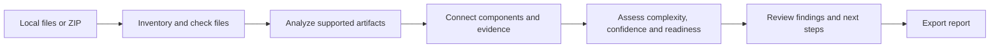

# How the tool works

A user supplies an application export. The tool looks for recognizable pieces and records what it finds. It then explains what those pieces may mean for migration planning.

Imagine a recipe book: a job is a recipe, a program is a step, and a dataset is an ingredient or finished dish. The tool traces the recipe and points back to the page that describes each connection. It also marks missing pages.

The interface shows an overview, a searchable component list, a dependency graph, findings with evidence and a report. An optional AI assistant can propose explanations or questions for human review. The deterministic core is designed to work without it.
