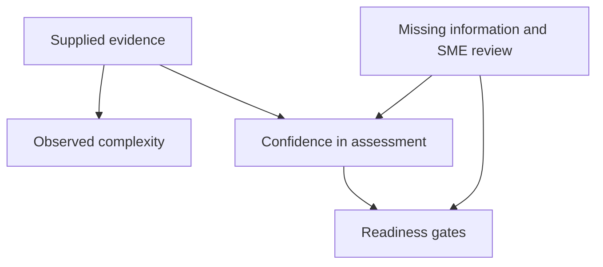

# Understanding the three assessments

The three answers are related, but they are not the same.

| Question | Meaning | Example |
|---|---|---|
| How complex? | How difficult might the observed characteristics make migration? | Several flows share a dataset. |
| How confident? | How much reliable evidence supports the assessment? | The supplied scheduler files could not be analyzed. |
| Ready for planning? | Are key planning questions understood and reviewed? | Recovery procedures are still unknown. |

A complicated application can be well understood and ready for planning. A simple-looking one can be poorly understood and not ready.

An unknown is not a low score. The tool should say **unknown** when it lacks evidence and show which questions prevent a decision. Results are planning aids based on documented team rules, not predictions of cost or duration.
