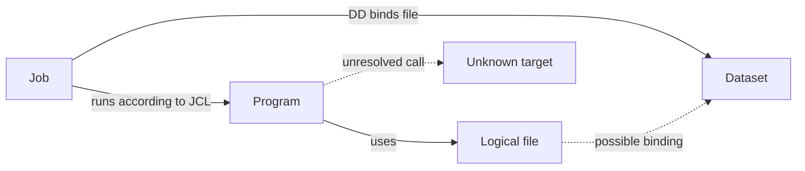

# Evidence, dependencies and gaps

**Evidence** is the source of a claim: for example, a particular line in a JCL file. A **dependency** is a connection, such as a job referring to a program. A **gap** is something the team needs but does not have or cannot interpret.

A graph lets an analyst explore these connections. Selecting an edge should open the artifact and source location behind it. A table offers the same information for searching and export.

Four labels keep the story honest:

- **Observed:** a statement exists in a supplied artifact.
- **Inferred:** an interpretation based on evidence.
- **Unknown:** information is missing or unresolved.
- **Confirmed by an SME:** a named reviewer has validated a statement.

A program-to-dataset binding may need evidence from both the program and its JCL DD statement; label the connection inferred until it is resolved. A static source reference does not prove a program ran in production. Likewise, parsing all supplied files does not prove all application files were supplied. The coverage screen must show both the artifacts received and known missing categories.
