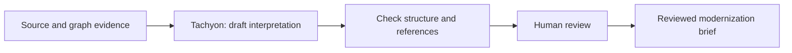

# What the LLM adds

An LLM can help translate technical evidence into material a wider team can review. Think of it as a draft writer with an open book: it can explain what it sees and ask questions, but a person still checks whether the explanation is right.

Given a selected flow and its evidence, it can propose:

- A plain-language explanation of what the flow appears to do.
- Candidate business rules and examples to discuss with a business SME.
- Modernization risks, questions and evidence to obtain.
- Candidate test scenarios and possible component boundaries.

A valid source link does not guarantee that an interpretation is correct. All generated rules and recommendations remain proposals until reviewed. The tool should record unknowns and show the evidence used. The core inventory, graph and assessment rules work without the LLM.

Tachyon's endpoint location, available model features and license must be checked. A remote endpoint would require an explicit exception to the no-network requirement; see [external dependencies](external-dependencies.md).
